# Instituto Códice - Sistema de Asistencia y Notas

[](https://github.com/Pazvzv24/InstitutoCodice/actions/workflows/ci.yml)

Aplicación de escritorio para gestión académica: estudiantes, asignaturas, inscripciones, asistencia, calificaciones e informes, con control de acceso por rol.
Proyecto académico de **AIEP**, carrera **Técnico en Programación y Análisis de Sistemas**: Tarea 3 del ramo **PRO205 Taller de Programación**, continuado como proyecto de portafolio. Ver [Contexto](#contexto).

**Stack:** C# / .NET 8 / Windows Forms / SQL Server / MSTest / Microsoft.Extensions.DependencyInjection / ClosedXML / QuestPDF

### Capturas

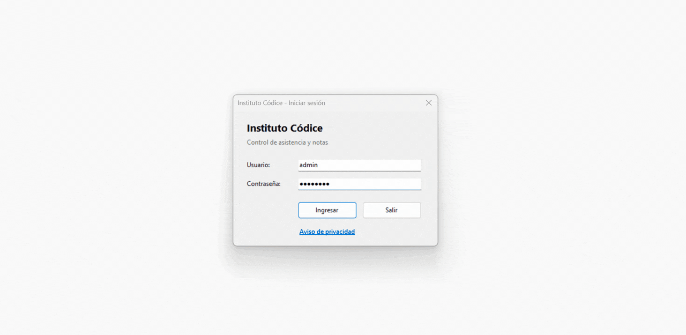

| Inicio de sesión | Menú principal (administrador) |
| :---: | :---: |
| 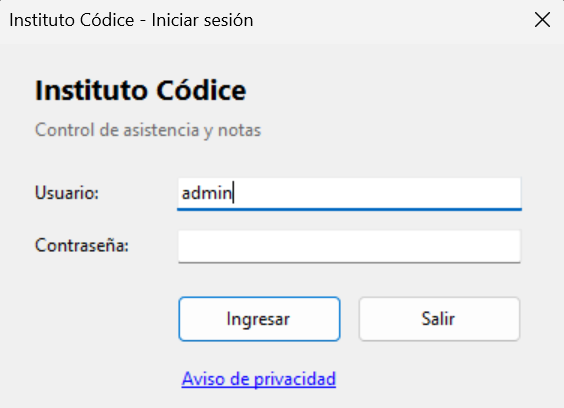 | 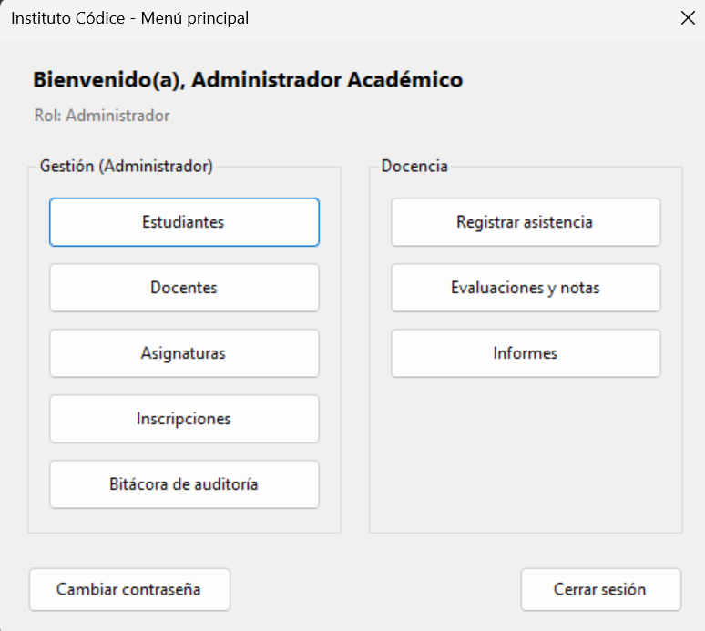 |
| **Estudiantes** | **Evaluaciones y notas** |
| 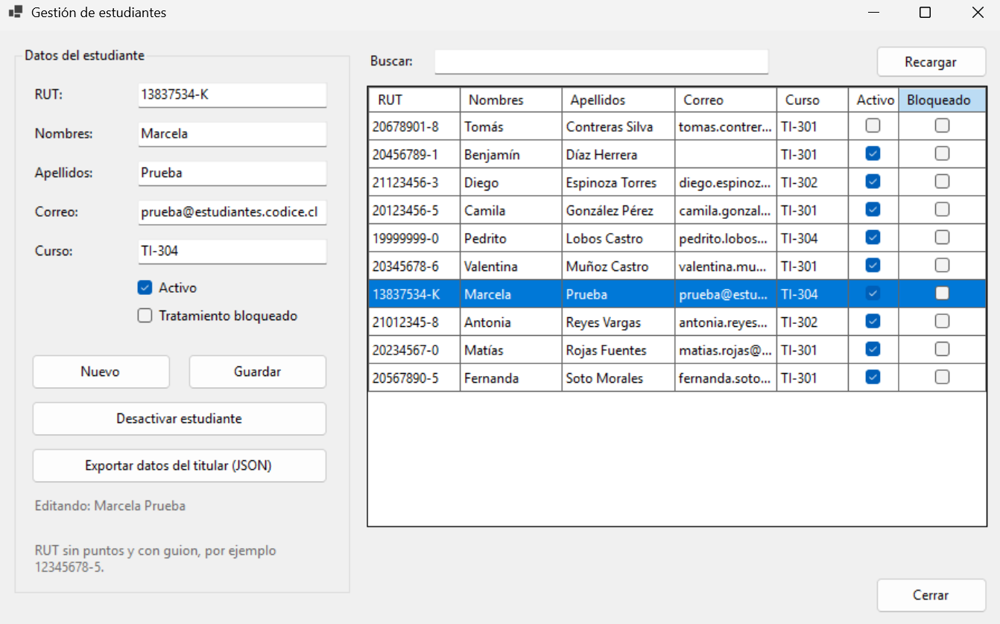 | 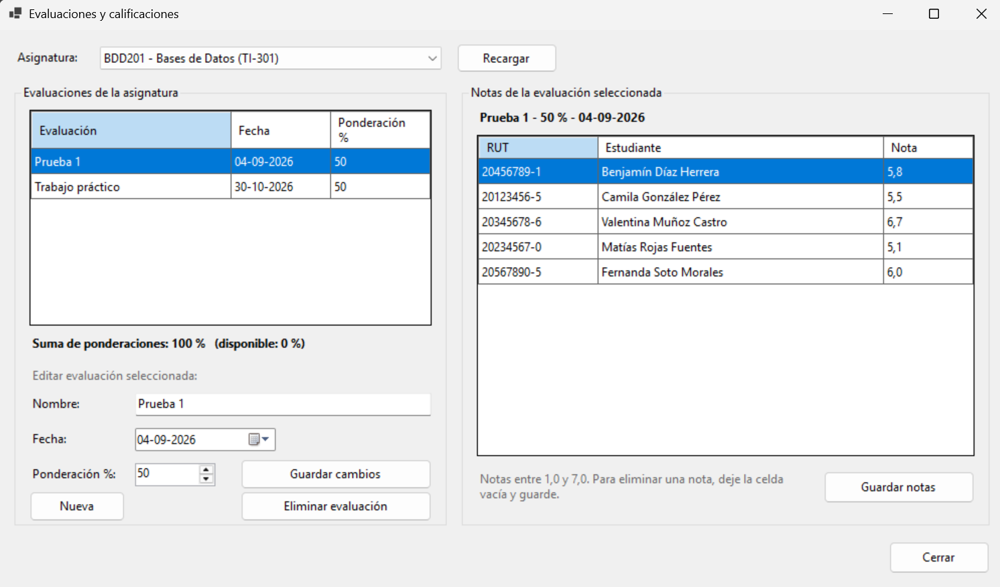 |
| **Informe por curso** | **Bitácora de auditoría** |
| 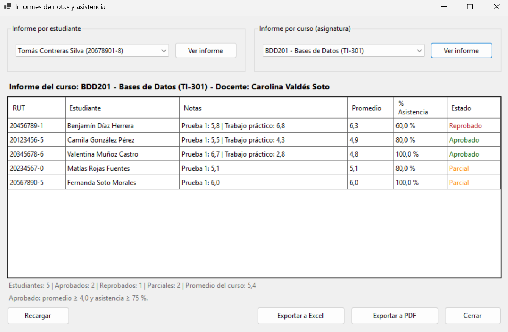 | 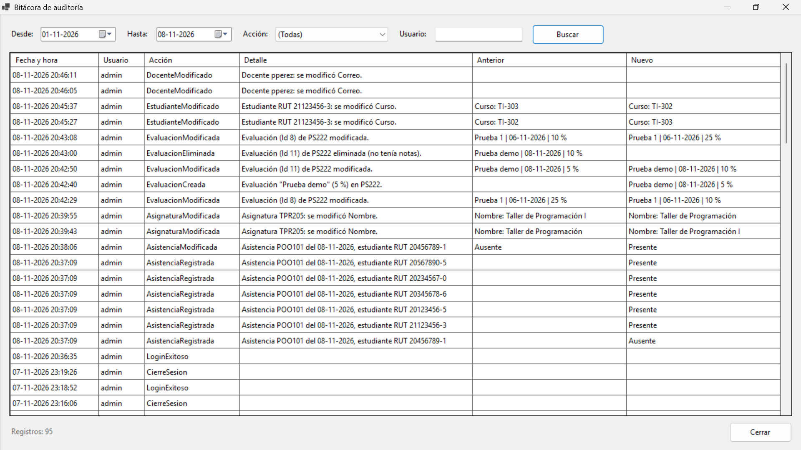 |

<details>
<summary><b>Más capturas</b></summary>

| Docentes | Asignaturas |
| :---: | :---: |
| 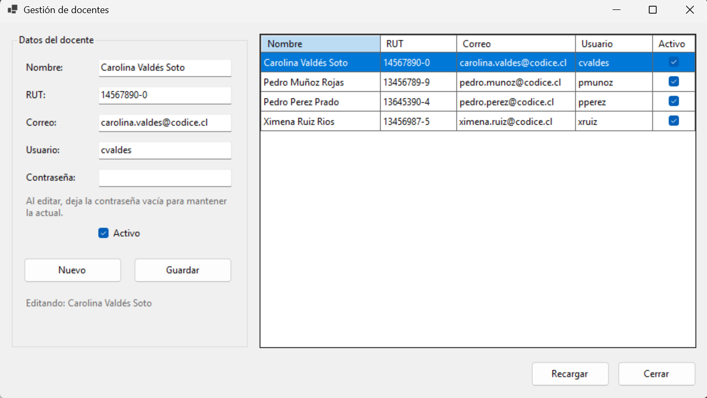 | 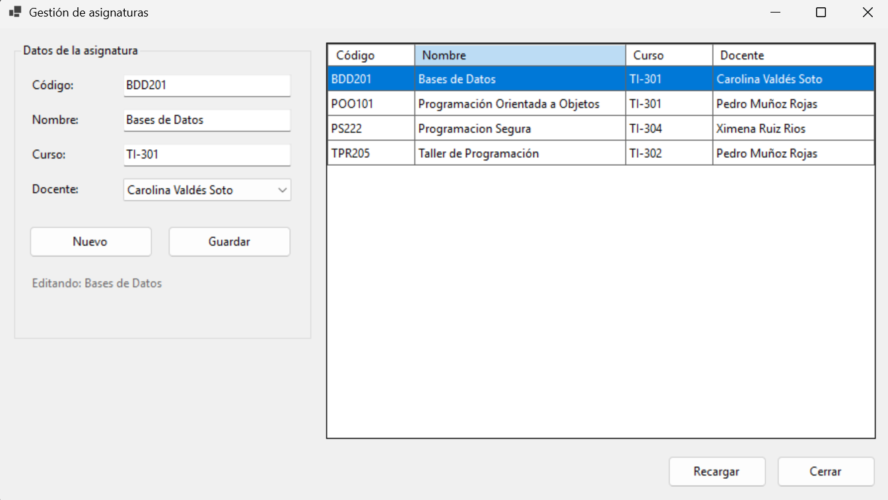 |
| **Inscripciones** | **Registro de asistencia** |
| 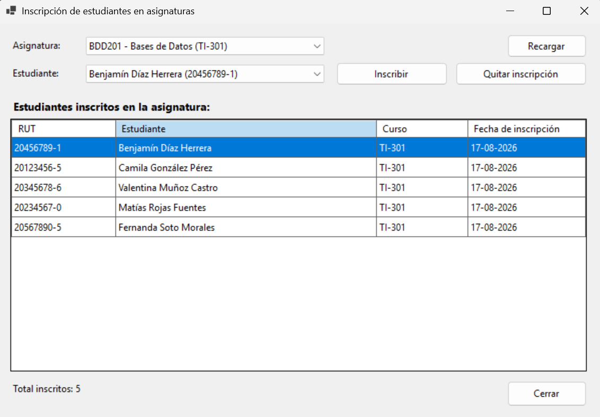 | 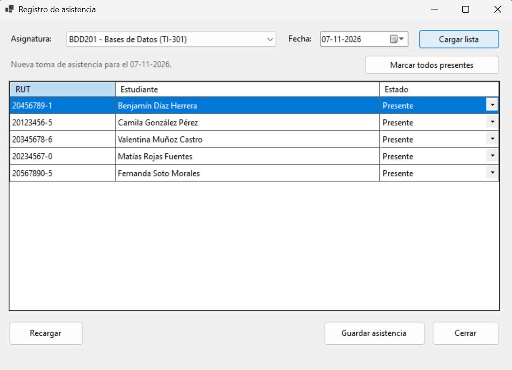 |
| **Aviso de privacidad (Ley 21.719)** | **Prueba de permisos de la cuenta de la aplicación** |
| 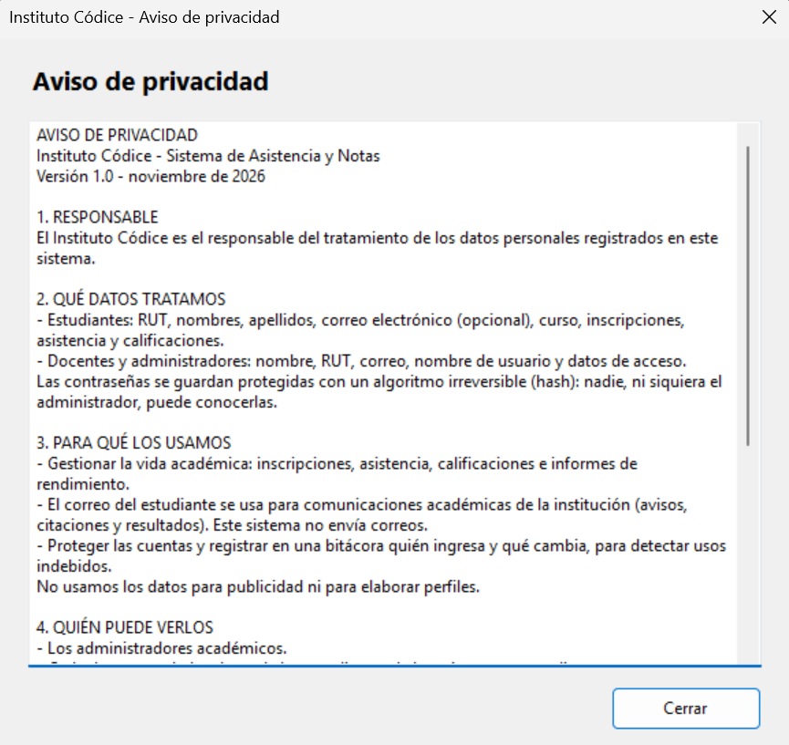 | 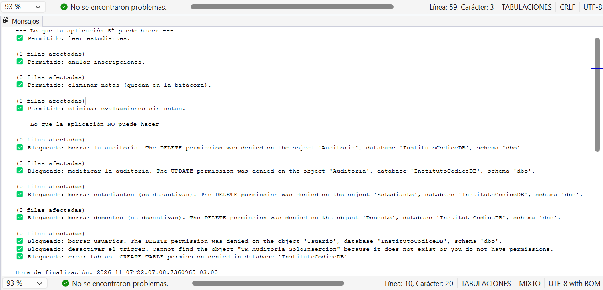 |
| **Informe exportado a PDF** | **Informe exportado a Excel** |
| 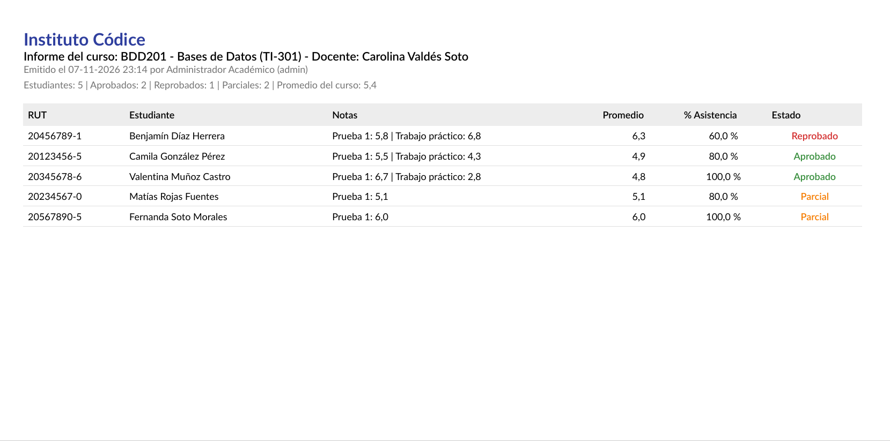 | 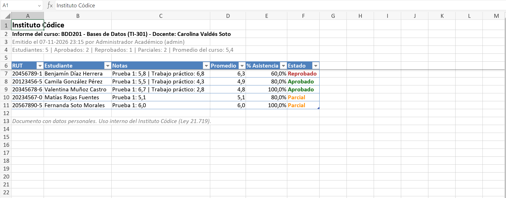 |

</details>

> Todos los datos que aparecen en las capturas son ficticios.

---

### Descarga (sin Visual Studio)

1. Descargar `InstitutoCodice-v2.0-win-x64.zip` desde [Releases](https://github.com/Pazvzv24/InstitutoCodice/releases/latest).
2. Opcional, recomendado: verificar que el archivo no fue alterado comparando su huella SHA-256 con la publicada en la release:
   ```powershell
   Get-FileHash .\InstitutoCodice-v2.0-win-x64.zip -Algorithm SHA256
   ```
3. Descomprimir y ejecutar `InstitutoCodice.App.exe`. No requiere instalar .NET (va incluido).
4. Requiere **SQL Server Express o LocalDB** en el equipo. En la primera ejecución la app crea la base con los datos de demostración. El servidor se cambia en `appsettings.json`, junto al `.exe` (ver [Elegir el servidor SQL](#instalación-rápida)).
5. Ingresar con `admin` / `Admin123`.

> El ejecutable no está firmado digitalmente (proyecto académico), por lo que Windows SmartScreen puede mostrar "Windows protegió su PC". Para continuar: **Más información → Ejecutar de todas formas**. Por eso conviene verificar la huella SHA-256 del paso 2.


### Requisitos

- Visual Studio 2022 (v17.8+)
- Workload: Desarrollo de escritorio de .NET
- SQL Server Express o LocalDB (SSMS opcional)

### Instalación rápida

1. Abrir `InstitutoCodice.sln` y presionar **F5** (el proyecto de inicio es `InstitutoCodice.App`).
2. En la primera ejecución, la app detecta que la base no existe y ofrece crearla con los datos de demostración.
3. Ingresar con `admin` / `Admin123`.

**Elegir el servidor SQL**

El servidor se configura en `InstitutoCodice.App/appsettings.json` (en la versión publicada, junto al `.exe`), sin recompilar:

```json
{
  "BaseDatos": {
    "Servidor": "localhost\\SQLEXPRESS",
    "Nombre": "InstitutoCodiceDB",
    "CrearSiNoExiste": true,
    "CertificadoServidor": ""
  }
}
```

- SQL Server Express: `localhost\\SQLEXPRESS`
- LocalDB (incluido con Visual Studio): `(localdb)\\MSSQLLocalDB`

La conexión usa autenticación de Windows: no se guardan usuarios ni contraseñas de SQL.

`CertificadoServidor` vacío = modo desarrollo (conexión cifrada sin verificar el certificado). En producción se indica la ruta del certificado del servidor: ver [docs/CertificadoSQL.md](docs/CertificadoSQL.md).

**Cuenta de la aplicación con mínimo privilegio (opcional, recomendado)**

Por defecto la app usa autenticación de Windows, necesaria para instalar la base. Para el uso diario puede conectarse con una cuenta limitada:

1. Activar en SQL Server el modo de autenticación "Windows y SQL Server" y reiniciar el servicio.
2. Como administrador, crear el login (la contraseña nunca se guarda en el repositorio):
   ```sql
   CREATE LOGIN app_codice WITH PASSWORD = N'...', DEFAULT_DATABASE = InstitutoCodiceDB, CHECK_POLICY = ON;
   ```
3. Ejecutar `BaseDatos/07_Rol_App_Codice.sql` (crea el rol `rol_app_codice` con sus permisos mínimos y asigna el usuario).
4. Crear en Windows la variable de entorno de usuario `INSTITUTOCODICE_DB_CLAVE` con la contraseña.
5. Crear `InstitutoCodice.App/appsettings.local.json` (está en `.gitignore`):
   ```json
   { "BaseDatos": { "Autenticacion": "Sql" } }
   ```
6. Opcional: ejecutar `BaseDatos/08_PruebaPermisos.sql` para comprobar qué puede y qué no puede hacer la cuenta de la aplicación (todas las líneas deben salir con ✅).

**Instalación manual (opcional)**

También se puede crear la base desde SSMS ejecutando en orden:

- `BaseDatos/01_InstitutoCodiceDB.sql` -> Crea la BD y las 9 tablas.
- `BaseDatos/02_DatosEjemplo.sql` -> Carga datos de prueba.

**Actualización (solo instalaciones anteriores a la v1.1)**

- `BaseDatos/03_ActualizarHashesPBKDF2.sql` -> Migra las contraseñas de las cuentas demo de SHA-256 a PBKDF2 y agrega la restricción de formato del hash.

**Actualización (solo instalaciones anteriores a la v1.3)**

- `BaseDatos/04_BloqueoDeCuenta.sql` -> Agrega las columnas de bloqueo de cuenta. Incluye el comando para desbloquear una cuenta manualmente.

**Actualización (solo instalaciones anteriores a la v1.4)**

- `BaseDatos/05_CambioDeContrasena.sql` -> Agrega el cambio de contraseña obligatorio.

**Actualización (solo instalaciones anteriores a la v1.5)**

- `BaseDatos/06_Auditoria.sql` -> Crea la bitácora de auditoría.

**Actualización (solo instalaciones anteriores a la v1.9)**

- `BaseDatos/09_BloqueoTratamiento.sql` -> Agrega el bloqueo del tratamiento de datos (Ley 21.719). Ejecutar con una cuenta administradora.

**Actualización (solo instalaciones anteriores a la v2.0)**

- `BaseDatos/10_PermisosEliminacion.sql` -> Permite a la cuenta de la aplicación eliminar notas y evaluaciones sin notas. Ejecutar con una cuenta administradora.

**Pruebas**
- Menú **Prueba -> Ejecutar todas las pruebas** (46 pruebas unitarias, no requieren base de datos).
- Desde la consola: `dotnet test InstitutoCodice.sln`

**Integración continua**

En cada push, [GitHub Actions](.github/workflows/ci.yml) compila la solución en Windows, ejecuta las pruebas y revisa si algún paquete NuGet tiene vulnerabilidades conocidas (incluidas las dependencias transitivas). También se ejecuta cada lunes, para detectar vulnerabilidades descubiertas después del último cambio. El workflow tiene solo permisos de lectura y no usa secretos.

[Dependabot](.github/dependabot.yml) propone automáticamente las actualizaciones de seguridad de los paquetes NuGet como pull requests, que pasan por las mismas pruebas antes de aceptarse.

**Seguridad del repositorio (GitHub)**

| Control | Qué hace |
| :--- | :--- |
| CodeQL | Análisis estático de seguridad del código C# y del workflow en cada push, pull request y semanalmente |
| Dependabot | Alertas de vulnerabilidades y de malware en dependencias; pull requests automáticos con las correcciones de seguridad |
| Secret Protection | Detecta contraseñas, tokens y claves en el historial del repositorio |
| Push protection | Bloquea un push que contenga un secreto antes de que llegue a GitHub |
| Reporte privado de vulnerabilidades | Canal privado para informar fallas de seguridad (pestaña *Security*). Ver la [política de seguridad](SECURITY.md) |

### Cuentas de prueba

> Credenciales ficticias de demostración, solo para entorno local. Las cuentas demo no exigen cambio de contraseña al ingresar.

| Usuario | Contraseña | Rol | Asignaturas |
| :--- | :--- | :--- | :--- |
| **admin** | Admin123 | Administrador | Todas |
| **pmunoz** | Docente123 | Docente | POO101, TPR205 |
| **cvaldes** | Docente123 | Docente | BDD201 |

La contraseña distingue mayúsculas. Al 3er intento fallido la app se cierra y la cuenta queda bloqueada 15 minutos.

### Seguridad

El diseño de seguridad se analizó con la metodología STRIDE: [modelo de amenazas](docs/ModeloAmenazas.md) con 20 amenazas, sus controles y los riesgos residuales.

| Control | Implementación |
| :--- | :--- |
| Hash de contraseñas | PBKDF2-SHA256, 600.000 iteraciones, sal aleatoria de 16 bytes (recomendación OWASP) |
| Formato versionado | `PBKDF2$iteraciones$sal$hash`: permite subir iteraciones o cambiar de algoritmo sin invalidar hashes |
| Comparación segura | `CryptographicOperations.FixedTimeEquals` (tiempo constante, evita ataques de temporización) |
| Defensa en la BD | Restricción `CK_Usuario_HashFormato`: la base rechaza contraseñas en texto plano |
| Límite de intentos | Al 3er intento fallido la aplicación se cierra; mensaje genérico "usuario o contraseña incorrectos" |
| Bloqueo de cuenta | 3 intentos fallidos bloquean la cuenta 15 minutos, guardado en la BD (persiste al reiniciar la app); durante el bloqueo no se verifica la contraseña |
| Control de acceso | Un docente solo ve estudiantes, asignaturas e informes de los cursos que dicta; filtrado en la interfaz y en el servicio (defensa en profundidad); si no hay permisos definidos, no muestra nada (falla cerrada); cubierto por pruebas automáticas |
| Política de contraseñas | Mínimo 8 caracteres con mayúscula, minúscula y número; no puede contener el usuario ni repetir la actual |
| Cambio obligatorio | Una contraseña asignada o restablecida por el administrador debe cambiarse en el siguiente ingreso |
| Bitácora de auditoría | Registra ingresos, fallos, bloqueos y cambios de contraseña; altas, modificaciones, desactivaciones y reactivaciones de estudiantes y docentes; altas y modificaciones de asignaturas; inscripciones y anulaciones; cambios y eliminaciones de evaluaciones; cada nota registrada, modificada o eliminada, y cada asistencia registrada o modificada, con su valor anterior y nuevo. Identifica al estudiante por RUT y, de nombres, RUT de docentes y correos, registra solo qué campo cambió, no su valor (minimización de datos) |
| Mínimo privilegio | La app se conecta con `app_codice` (rol `rol_app_codice`): solo lee, inserta y actualiza; borra solo inscripciones, notas y evaluaciones sin notas; no puede modificar la bitácora, crear tablas ni desactivar triggers |
| Secretos fuera del código | La contraseña de la cuenta de la app se lee desde una variable de entorno; la configuración local está en `.gitignore` |
| Bitácora inmutable | Un trigger en la BD rechaza UPDATE y DELETE sobre la tabla Auditoria; los cambios de estudiantes, docentes, asignaturas, inscripciones, evaluaciones, notas y asistencia se auditan en la misma transacción que el cambio: se guardan los dos o ninguno |
| Exportación controlada | Los informes se exportan a Excel o PDF solo con los datos que el usuario ya puede ver; cada exportación queda en la bitácora; las celdas de Excel se escriben como texto (evita la inyección de fórmulas) |
| Aviso de privacidad | Accesible desde el login, antes de ingresar: responsable, datos tratados, finalidad, quién accede, conservación y derechos (Ley 21.719) |
| Derechos del titular | Exportación de todos los datos de un estudiante en JSON (acceso y portabilidad), solo para el administrador, sin datos de terceros y con registro en la bitácora |
| Bloqueo del tratamiento | Un estudiante con el tratamiento bloqueado no aparece en inscripciones, asistencia, calificaciones ni informes; su historial se conserva y sus datos se pueden seguir exportando |
| Cifrado en tránsito | La conexión a SQL Server siempre va cifrada (TLS); en producción, la app solo acepta el certificado configurado del servidor (fijación de certificado) y rechaza servidores impostores |
| Inyección SQL | Todas las consultas son parametrizadas |
| Configuración | Conexión en `appsettings.json` con autenticación de Windows, sin credenciales en el código |
| Instalación segura | La creación automática solo actúa si la base no existe y solo ejecuta los scripts incluidos con la app |
| Integridad de datos | Reglas de negocio validadas en el código y en la BD (CHECK, UNIQUE, FOREIGN KEY) |

### Protección de datos personales (Ley 21.719)

El sistema se diseñó considerando la Ley N° 21.719 de protección de datos personales de Chile.

- [Registro de actividades de tratamiento](docs/RegistroTratamiento.md): qué datos se tratan, para qué, quién accede, cuánto tiempo se conservan, medidas de seguridad y brechas detectadas con su plan de acción.
- [Verificación del certificado de SQL Server](docs/CertificadoSQL.md): cómo configurar la conexión para que solo acepte el servidor verdadero.
- [Plan de respuesta ante incidentes](docs/PlanRespuestaIncidentes.md): cómo detectar, contener, evaluar, notificar y registrar una vulneración de seguridad, con consultas de apoyo sobre la bitácora.
- **Deber de información:** aviso de privacidad en la pantalla de inicio de sesión.
- **Derechos de acceso y portabilidad:** exportación de los datos del titular en JSON, un formato estructurado que otro sistema puede leer.
- **Derecho de bloqueo:** el administrador puede bloquear temporalmente el tratamiento de los datos de un estudiante sin borrar su historial. Bloquear y desbloquear quedan en la bitácora.
- **Minimización:** la bitácora identifica a los estudiantes solo por RUT, registra que un nombre o correo cambió sin guardar su valor, y las exportaciones no incluyen datos de terceros.
- **Responsabilidad proactiva:** cada acceso, cada creación o modificación de estudiantes y docentes, cada inscripción, cada cambio de nota o de asistencia y cada exportación queda en una bitácora inmutable.
- **Respuesta ante incidentes:** plan documentado con roles, fases, criterios de notificación y registro de incidentes.

Pendiente de la institución: definir los plazos de conservación e instalar el certificado del servidor en producción.

> Proyecto académico y de portafolio: la documentación describe cómo el sistema facilita el cumplimiento, pero no constituye asesoría legal.

### Arquitectura (3 capas)

- **Negocio** (`InstitutoCodice.Negocio`): Modelos UML, lógica de informes, seguridad y validación de RUT.
- **Datos** (`InstitutoCodice.Datos`): Conexión a SQL y repositorios.
- **Presentación** (`InstitutoCodice.App`): Formularios Windows Forms.
- **Pruebas** (`InstitutoCodice.Pruebas`): Pruebas unitarias MSTest con patrón AAA y fuentes de datos falsas (sin base de datos).

**Inyección de dependencias:** los formularios no crean sus repositorios; los reciben por el constructor. `Contenedor.cs` (con `Microsoft.Extensions.DependencyInjection`) es la raíz de composición: el único lugar donde se decide qué implementación se usa. `ServicioInformes` depende de la interfaz `IFuenteDatosInformes`, lo que permite probarlo con datos falsos. El contenedor valida todos los registros al iniciar (`ValidateOnBuild`).
- **BaseDatos**: Scripts SQL de instalación y actualización.

### Trazabilidad

| Requerimiento | Código |
| :--- | :--- |
| RF-01, RF-02 (Estudiantes) | `FormEstudiantes`, `ValidarRut()`, `Desactivar()` |
| RF-03 (Asignaturas) | `FormAsignaturas` |
| RF-04 (Inscripciones) | `FormInscripciones`, `EsDuplicada()` (con prueba automática) |
| RF-05, RF-06 (Asistencia) | `FormAsistencia`, `ValidarFecha()` |
| RF-07, RF-08 (Notas) | `FormCalificaciones`, `ValidarNota()` |
| RF-09, RF-10, RF-11 (Informes) | `FormInformes`, `ServicioInformes`, `EsDefinitivo()`, `ExportadorInformes` (Excel/PDF) |
| RF-12 (Login) | `FormLogin`, `VerificarContrasena()`, límite de 3 intentos, `PoliticaBloqueo` |
| RNF-03 (Seguridad) | `Seguridad` (PBKDF2-SHA256 con sal) + restricción de formato en BD + queries parametrizadas |
| RNF-03 (Contraseñas) | `PoliticaContrasena`, `FormCambiarContrasena` |
| Auditoría | `Bitacora`, `AuditoriaRepositorio`, `FormAuditoria`, `AccionAuditoria.DetalleNota()`, `AccionAuditoria.DetalleAsistencia()`, `CambiosAuditoria` (qué campos cambiaron), tabla `Auditoria` |
| Ley 21.719 (información) | `AvisoPrivacidad`, `FormAvisoPrivacidad`, `docs/RegistroTratamiento.md` |
| Ley 21.719 (acceso y portabilidad) | `ServicioDatosTitular`, botón "Exportar datos del titular" en `FormEstudiantes` |
| Ley 21.719 (bloqueo) | `Estudiante.PuedeTratarse()`, `ServicioInformes`, casilla "Tratamiento bloqueado" en `FormEstudiantes`, `09_BloqueoTratamiento.sql` |
| RNF-07 (Errores) | `Conexion.Probar()` y handler global en `Program.cs` |
| Instalación | `InstaladorBaseDatos`, `appsettings.json` |
| Cifrado en tránsito | `Conexion` (`CertificadoServidor`), `docs/CertificadoSQL.md` |

### Reglas del negocio

- RUT validado con módulo 11.
- Notas entre 1.0 y 7.0.
- Ponderaciones por asignatura no superan 100%.
- No se permite asistencia en fecha futura.
- No se elimina historial: usuarios se desactivan.
- Aprobación: Promedio >= 4.0 y Asistencia >= 75%.
- Resultado **Parcial**: si las evaluaciones con nota no suman el 100% de la ponderación, el estado no es definitivo y no se informa como aprobado ni reprobado.
- Un docente solo accede a la información de sus propias asignaturas; el administrador accede a todo.
- Una evaluación se puede editar sin que la suma de ponderaciones supere el 100 %, y solo se puede eliminar si no tiene notas (lo valida la aplicación y también la base de datos).
- Una nota se elimina dejando su celda vacía; la eliminación queda en la bitácora con la nota que tenía.
- Estudiantes y docentes no se eliminan, se desactivan (borrado lógico): así se conserva el historial académico y la trazabilidad.

### Contexto

Este sistema nació como la Tarea 3 del ramo PRO205 Taller de Programación (AIEP). La **v1.0** corresponde a la versión entregada en la evaluación.

Desde la **v1.1 hasta la v2.0**, el proyecto continuó como trabajo personal de portafolio, con foco en **seguridad desde el diseño**:

- Contraseñas con PBKDF2 y bloqueo de cuenta.
- Bitácora de auditoría inmutable.
- Mínimo privilegio en la base de datos.
- Protección de datos personales según la Ley 21.719.
- Integración continua con análisis de seguridad.
- Modelo de amenazas STRIDE.

No se incluyen el enunciado, la pauta de evaluación ni datos de la institución: todos los datos del sistema son ficticios.

### Historial de versiones

| Versión | Cambios |
| :--- | :--- |
| v1.0 | Versión entregada en la evaluación. |
| v1.1 | Scripts de instalación incluidos en el proyecto; límite de 3 intentos en login; control de acceso en informes individuales; estado Parcial; migración a PBKDF2; 5 pruebas nuevas (autenticación y resultado parcial). |
| v1.2 | Configuración en `appsettings.json`; soporte para LocalDB; creación automática de la base en la primera ejecución. |
| v1.3 | Bloqueo de cuenta persistente (3 intentos = 15 minutos); 4 pruebas nuevas del bloqueo. |
| v1.4 | Política de contraseñas; formulario para cambiar la contraseña; cambio obligatorio tras asignación del administrador; 4 pruebas nuevas. |
| v1.5 | Bitácora de auditoría inmutable con pantalla de consulta para el administrador; 2 pruebas nuevas. |
| v1.6 | Mínimo privilegio: cuenta de la aplicación con rol limitado; contraseña desde variable de entorno; configuración local fuera del repositorio. |
| v1.7 | Exportación de informes a Excel (ClosedXML) y PDF (QuestPDF) con registro en la bitácora; 1 prueba nueva. |
| v1.8 | Calidad de código: inyección de dependencias en todos los formularios; bitácora con RUT del estudiante; pruebas de control de acceso e inscripción duplicada; corrección de advertencias de nulos; 5 pruebas nuevas. |
| v1.9 | Ley 21.719: registro de actividades de tratamiento; aviso de privacidad; exportación de datos del titular en JSON; bloqueo del tratamiento; verificación opcional del certificado de SQL Server; plan de respuesta ante incidentes; corrección de advertencias de nulos; 7 pruebas nuevas. |
| v1.10 | Integración continua con GitHub Actions: compilación, pruebas y revisión de paquetes vulnerables en cada push y cada semana; Dependabot para actualizaciones de seguridad; análisis CodeQL; protección de secretos; reporte privado de vulnerabilidades; badge en el README. |
| v2.0 | Presentación final: modelo de amenazas STRIDE; política de seguridad (`SECURITY.md`); varias pantallas abiertas a la vez (se cierran todas al cerrar sesión); pantallas que se adaptan al tamaño de la ventana; botón Recargar y tecla F5; edición y eliminación de evaluaciones; eliminación de notas con registro en la bitácora; auditoría de cambios de estudiantes, docentes, asignaturas, inscripciones, evaluaciones y asistencia en la misma transacción, con minimización de datos personales; capturas de pantalla y GIF de demostración en el README; release con ejecutable para Windows (autocontenido, sin instalar .NET); 8 pruebas nuevas. |

### Licencias de terceros

- [ClosedXML](https://github.com/ClosedXML/ClosedXML): MIT.
- [Microsoft.Extensions.DependencyInjection](https://github.com/dotnet/runtime): MIT.
- [QuestPDF](https://www.questpdf.com/license/): licencia Community (gratuita para personas y organizaciones con ingresos anuales menores a 1 millón USD).