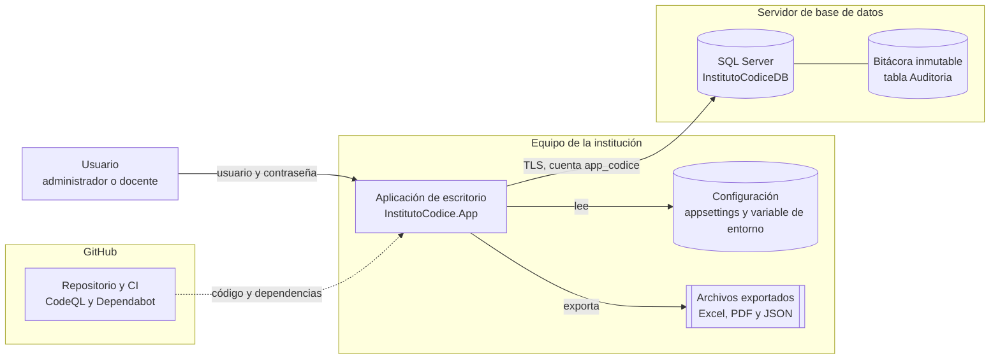

# Modelo de amenazas (STRIDE)

**Sistema:** Instituto Códice - Sistema de Asistencia y Notas
**Versión del sistema analizada:** v1.10
**Metodología:** STRIDE por elemento del diagrama de flujo de datos
**Versión del documento:** 1.1 - noviembre de 2026

Este documento identifica qué podría salir mal en el sistema desde el punto de vista de la seguridad, qué control lo evita o lo reduce y qué riesgo queda. Complementa el [registro de actividades de tratamiento](RegistroTratamiento.md) (qué datos se protegen) y el [plan de respuesta ante incidentes](PlanRespuestaIncidentes.md) (qué hacer si un control falla).

---

## 1. Diagrama de flujo de datos

Cada recuadro con borde es un **límite de confianza**: el punto donde los datos pasan de una zona a otra y donde un atacante podría intervenir.

| Límite de confianza | Qué cruza | Riesgo principal |
| :--- | :--- | :--- |
| Usuario → aplicación | Credenciales y datos ingresados | Suplantación de identidad, datos maliciosos |
| Aplicación → SQL Server | Consultas, credencial de `app_codice` | Servidor impostor, inyección SQL |
| Aplicación → archivos exportados | Datos personales que salen del sistema | Divulgación |
| GitHub → aplicación | Código fuente y paquetes NuGet | Dependencias vulnerables o maliciosas |

---

## 2. Análisis STRIDE

**Riesgo residual:** 🟢 bajo · 🟡 medio · 🔴 alto, considerando los controles implementados.

### S - Suplantación de identidad (*Spoofing*)

| Id | Amenaza | Controles implementados | Riesgo residual |
| :--- | :--- | :--- | :--- |
| S1 | Un atacante adivina o prueba contraseñas para entrar como un docente o como el administrador | Contraseñas con hash PBKDF2-SHA256 (600.000 iteraciones y sal); política de contraseñas; bloqueo de la cuenta por 15 minutos tras 3 intentos fallidos, guardado en la base; la aplicación se cierra al tercer intento; mensaje genérico "usuario o contraseña incorrectos" (`Seguridad`, `PoliticaBloqueo`, `PoliticaContrasena`) | 🟡 No hay segundo factor de autenticación (MFA) |
| S2 | Un servidor impostor en la red se hace pasar por SQL Server y captura la contraseña de `app_codice` | Conexión siempre cifrada (TLS); con `CertificadoServidor` configurado, solo se acepta el certificado del servidor verdadero (`Conexion`, [CertificadoSQL.md](CertificadoSQL.md)) | 🟡 En modo desarrollo el certificado no se verifica |
| S3 | El administrador conoce la contraseña que asignó a un docente y la usa | El sistema obliga a cambiar toda contraseña asignada o restablecida en el siguiente ingreso (`DebeCambiarContrasena`) | 🟢 |

### T - Manipulación (*Tampering*)

| Id | Amenaza | Controles implementados | Riesgo residual |
| :--- | :--- | :--- | :--- |
| T1 | Un docente modifica notas de asignaturas que no dicta | Cada docente solo ve y edita sus asignaturas (`ListarParaUsuario`); notas validadas entre 1,0 y 7,0 en el código y en la base (CHECK); cada registro, cambio o eliminación de una nota queda en la bitácora con su valor anterior y nuevo, en la misma transacción | 🟢 |
| T2 | Inyección SQL a través de los campos de la aplicación | Todas las consultas son parametrizadas; la cadena de conexión se arma con `SqlConnectionStringBuilder` | 🟢 |
| T3 | Alguien borra o modifica la bitácora para ocultar lo que hizo | Trigger `TR_Auditoria_SoloInsercion` que rechaza UPDATE y DELETE; la cuenta de la aplicación tiene denegados UPDATE y DELETE sobre la tabla | 🟡 Un administrador de SQL Server (sysadmin) podría desactivar el trigger; se mitiga con la auditoría propia de SQL Server, fuera del alcance de la aplicación |
| T4 | Un nombre malicioso, por ejemplo `=HIPERVINCULO(...)`, se ejecuta como fórmula al abrir un informe en Excel | Las celdas de texto se escriben con formato de texto, por lo que Excel no las interpreta como fórmulas (`ExportadorInformes`) | 🟢 |
| T5 | Una dependencia NuGet o una acción de GitHub vulnerable o maliciosa introduce código dañino | Revisión de paquetes vulnerables en cada push y cada semana (CI); Dependabot con alertas de vulnerabilidades y de malware; solo acciones oficiales de GitHub; análisis CodeQL | 🟢 |

### R - Repudio (*Repudiation*)

| Id | Amenaza | Controles implementados | Riesgo residual |
| :--- | :--- | :--- | :--- |
| R1 | Un usuario niega haber cambiado una nota, exportado datos o bloqueado a un estudiante | Bitácora inmutable con usuario, fecha y hora (UTC), acción, detalle y valores anterior y nuevo: ingresos, fallos, bloqueos, cambios de contraseña, cambios y eliminaciones de notas y evaluaciones, exportaciones y bloqueos del tratamiento | 🟡 Si dos personas comparten una cuenta, la bitácora no puede distinguirlas: las cuentas deben ser personales |

### I - Divulgación de información (*Information disclosure*)

| Id | Amenaza | Controles implementados | Riesgo residual |
| :--- | :--- | :--- | :--- |
| I1 | Un docente ve datos de estudiantes de cursos que no dicta | Filtrado por asignatura en la interfaz **y** en el servicio (defensa en profundidad); si no hay permisos definidos, no se muestra nada (falla cerrada); cubierto por pruebas automáticas | 🟢 |
| I2 | Se filtra la base de datos y se obtienen las contraseñas de los usuarios | Solo se guardan hashes PBKDF2 con sal; la restricción `CK_Usuario_HashFormato` impide guardar contraseñas en texto plano | 🟢 |
| I3 | La contraseña de `app_codice` termina publicada en el repositorio | Se lee desde una variable de entorno; la configuración local está en `.gitignore`; Secret Protection y Push protection en GitHub | 🟢 |
| I4 | Un informe exportado llega a quien no corresponde | Solo se exporta lo que el usuario puede ver; cada exportación queda en la bitácora; los documentos llevan una leyenda de datos personales | 🔴 Una vez exportado, el archivo queda fuera del control del sistema. Se recomienda guardarlo solo en ubicaciones autorizadas y, si se divulga, aplicar el plan de incidentes |
| I5 | Se exponen más datos de los necesarios | Minimización: la bitácora identifica a los estudiantes solo por RUT; la exportación de datos del titular no incluye datos de terceros | 🟢 |

### D - Denegación de servicio (*Denial of service*)

| Id | Amenaza | Controles implementados | Riesgo residual |
| :--- | :--- | :--- | :--- |
| D1 | Un atacante bloquea a propósito la cuenta de un docente probando contraseñas incorrectas | El bloqueo es **temporal** (15 minutos) y no permanente; el administrador puede desbloquear la cuenta manualmente (`04_BloqueoDeCuenta.sql`) | 🟡 Es un compromiso consciente entre proteger la cuenta y mantenerla disponible |
| D2 | La base de datos no está disponible | La aplicación lo detecta al iniciar, con un tiempo de espera de 5 segundos, y muestra un mensaje claro en vez de cerrarse; manejador global de errores | 🟡 No hay alta disponibilidad (fuera del alcance de una aplicación de escritorio) |
| D3 | Una consulta de la bitácora con millones de registros congela la aplicación | La consulta devuelve como máximo los 500 registros más recientes | 🟢 |

### E - Elevación de privilegios (*Elevation of privilege*)

| Id | Amenaza | Controles implementados | Riesgo residual |
| :--- | :--- | :--- | :--- |
| E1 | Un docente accede a funciones de administrador | Los botones de gestión se desactivan según el rol; la bitácora y la exportación de datos del titular vuelven a comprobar el rol al abrirse (defensa en profundidad) | 🟡 Las demás pantallas de gestión (estudiantes, docentes, asignaturas, inscripciones) dependen solo del menú. Mejora propuesta: comprobar el rol también al abrir cada una |
| E2 | Si la aplicación fuera comprometida, el atacante obtiene control total de la base | Mínimo privilegio: la cuenta `app_codice` solo lee, inserta y actualiza; borra solo inscripciones, notas y evaluaciones sin notas; no puede modificar la bitácora, crear tablas ni desactivar triggers. La instalación usa otra cuenta | 🟢 |
| E3 | Un workflow de GitHub comprometido modifica el código del repositorio | El workflow tiene solo permisos de lectura, no guarda la credencial de GitHub (`persist-credentials: false`) y no usa secretos | 🟢 |

---

## 3. Resumen

| Categoría | Amenazas | 🟢 | 🟡 | 🔴 |
| :--- | :---: | :---: | :---: | :---: |
| Suplantación | 3 | 1 | 2 | 0 |
| Manipulación | 5 | 4 | 1 | 0 |
| Repudio | 1 | 0 | 1 | 0 |
| Divulgación | 5 | 4 | 0 | 1 |
| Denegación de servicio | 3 | 1 | 2 | 0 |
| Elevación de privilegios | 3 | 2 | 1 | 0 |
| **Total** | **20** | **12** | **7** | **1** |

## 4. Riesgos residuales y mejoras propuestas

| Prioridad | Mejora | Amenazas |
| :---: | :--- | :--- |
| 1 | Comprobar el rol de administrador al abrir cada pantalla de gestión | E1 |
| 2 | Configurar el certificado del servidor SQL en producción | S2 |
| 3 | Segundo factor de autenticación (MFA) para el administrador | S1 |
| 4 | Cifrar los archivos exportados o entregarlos por un canal controlado | I4 |
| 5 | Activar la auditoría de SQL Server para las acciones de los administradores de la base | T3 |

---

## 5. Historial del documento

| Versión | Fecha | Cambios |
| :--- | :--- | :--- |
| 1.0 | Noviembre de 2026 | Versión inicial, sobre la versión v1.10 del sistema |
| 1.1 | Noviembre de 2026 | Eliminación de notas y de evaluaciones sin notas: se actualizan T1, R1 y E2 |